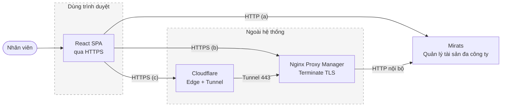

# 02 — Sơ đồ bối cảnh hệ thống (dạng flowchart)

> Ai dùng Mirats, hệ thống tương tác với cái gì bên ngoài.
> (Tương đương C4 mức 1 — dùng flowchart vì layout C4 chồng nhãn các mũi tên
> song song, xem ghi chú cuối.)

## 1. Mục đích / đối tượng đọc

Mọi đối tượng (lãnh đạo, dev, vận hành): một bức tranh duy nhất về ranh giới
hệ thống — người dùng và hệ ngoài nào chạm vào Mirats.

## 2. Sơ đồ

> Lý do dùng flowchart thay vì `C4Context`: layout C4 tự động chồng nhãn các
> mũi tên song song lên nhau (đã render kiểm chứng). Nội dung tương đương C4
> mức 1 (người dùng + hệ thống + hệ ngoài).

> Không có tích hợp chiều ra (mail/webhook/API công khai cho hệ khác) trong
> code hiện tại — backup và cảnh báo trong `DEPLOYMENT.md` đều làm thủ công.

## 3. Đọc sơ đồ

- Mirats là **một hệ thống duy nhất** đối với người dùng, dù trong có nhiều
  container (xem `03-c4-container.md`).
- Ba đường vào (a)/(b)/(c) khác nhau ở TLS + IP client backend thấy (xem
  `14-trien-khai.md`), nhưng nghiệp vụ phía trên không đổi.
- Không có tích hợp chiều ra (webhook/API công khai cho hệ khác) trong code
  hiện tại.

## Nguồn tham chiếu

- `docs/DEPLOYMENT.md` (§11: 3 cấu hình a/b/c)
- `aspire-react/aspire-react.AppHost/AppHost.cs` (ranh giới dev)
- `docker-compose.yml:22-128` (ranh giới prod)
