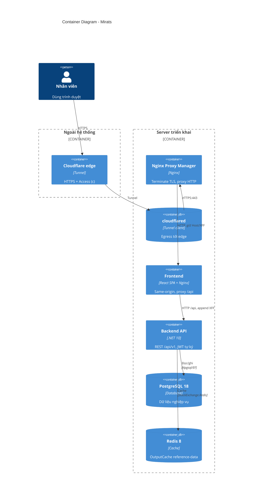

# 03 — Sơ đồ C4 mức 2: Container

> Mirats gồm những khối triển khai (container) nào, nói chuyện với nhau ra sao.

## 1. Mục đích / đối tượng đọc

Dev + vận hành: biết request đi qua những hop nào (quan trọng cho debug IP,
scheme, TLS), dữ liệu nằm ở đâu (Postgres/Redis/volume).

## 2. Sơ đồ (cấu hình đủ: prod sau NPM + tunnel)

Dev (Aspire) thay `fe` bằng Vite dev-server HTTPS + `api` chạy `dotnet run`,
bỏ NPM/tunnel; Postgres/Redis do Aspire cấp container tương đương.

## 3. Đọc sơ đồ

- Browser **không bao giờ gọi API trực tiếp**: mọi `/api` đi qua frontend nginx
  (same-origin, không CORS prod) — xem `aspire-react/frontend/nginx.conf:15-29`.
- Backend **không terminate TLS**: `ASPNETCORE_URLS=http://+:5000`
  (`docker-compose.yml:66`); TLS do NPM/edge làm.
- Redis chỉ cache **reference-data** (5 nhóm, TTL 300s) — dữ liệu nghiệp vụ
  (checkout/tồn kho) không cache (`AGENTS.md` Task P).
- `pgAdmin` chỉ chạy với `--profile debug`, không vẽ ở đây.

## Nguồn tham chiếu

- `docker-compose.yml:22-128` (5 services prod)
- `docker-compose.npm.yml` (network NPM + gỡ ports)
- `aspire-react/aspire-react.AppHost/AppHost.cs:14-40` (4 resources dev)
- `aspire-react/frontend/nginx.conf:15-29` (proxy /api)
