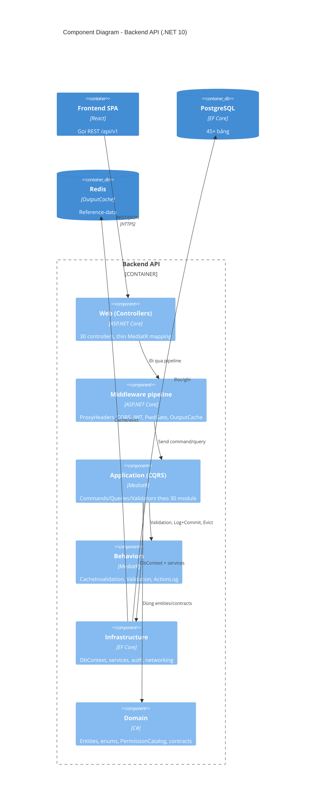

# 04 — Sơ đồ C4 mức 3: Component backend

> Trong backend .NET có những khối code nào, request đi qua chúng theo thứ tự gì.

## 1. Mục đích / đối tượng đọc

Dev backend: biết viết code mới ở đâu (DI đặt ở extension từng layer — Task Q),
request đi qua pipeline nào, log/audit gắn ở đâu.

## 2. Sơ đồ

## 3. Thứ tự pipeline (quan trọng — sai thứ tự là bug)

1. `UseProxyHeaders` (IP + scheme thật từ proxy tin cậy) — ĐẦU TIÊN.
2. `UseExceptionHandler` → `UseCors` → `UseAuthentication` (JWT tự ký).
3. `PasswordChangeGateMiddleware` (403 `MUST_CHANGE_PASSWORD` trừ 2 endpoint).
4. `UseAuthorization` (policy `<resource>.<action>` từ `PermissionCatalog`) →
   `UseOutputCache` → Controllers (mapping mỏng sang MediatR).
5. Trong MediatR: `CacheInvalidation` (ngoài) → `Validation` → Handler →
   `ActionLog` log+commit (trong) → Evict cache.

## 4. Đặt code mới ở đâu

| Muốn thêm | Đặt tại |
|---|---|
| Endpoint mới | Controller trong `Web/Controllers/` + Command/Query trong `Application/<Module>/` |
| Service dùng chung | `Infrastructure/Services/` + đăng ký trong `InfrastructureServiceCollectionExtensions.cs` (KHÔNG sửa `Program.cs` ngoài gọi extension) |
| Quyền mới | Thêm key vào `PermissionCatalog.All` (tự sinh policy + catalog API) |
| Validation | FluentValidation validator — tự chạy qua `ValidationBehavior` |
| Audit | Handler implement `ILoggableCommand` (log cùng transaction) |

## Nguồn tham chiếu

- `aspire-react/aspire-react.Server/Program.cs:58-103` (pipeline)
- `aspire-react/aspire-react.Application/ApplicationServiceCollectionExtensions.cs:18-37` (3 behaviors + thứ tự)
- `aspire-react/aspire-react.Infrastructure/InfrastructureServiceCollectionExtensions.cs:16-66` (DI theo layer)
- `aspire-react/aspire-react.Domain/Authorization/PermissionCatalog.cs:16-140` (~85 keys)
