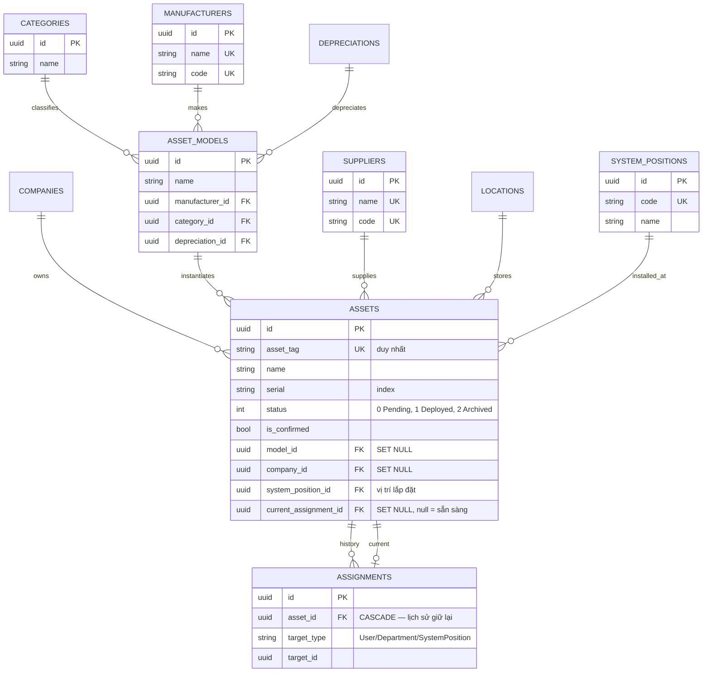

# 05 — ERD nhóm tài sản

> Bảng `assets` và các danh mục xung quanh. Thuộc tính liệt kê là cột chính
> (PK/FK/unique); xem entity đầy đủ trong `Domain/Entities/`.

## 1. Mục đích / đối tượng đọc

Dev cần thêm field/tra cứu quan hệ xóa (delete-guard chặn xóa khi còn tham
chiếu — xem `docs/ERROR_CODES.md` các mã `*_IN_USE`).

## 2. Sơ đồ

## 3. Quy tắc xóa (delete-guard)

- Xóa asset đã confirm/có lịch sử cấp phát → `400` (`ASSET_CONFIRMED_CANNOT_DELETE`,
  `ASSET_HAS_ASSIGNMENTS`, ...).
- Xóa model đang có asset → `400` không error_code (ghi chú DOC-ERR-1).
- Xóa category/manufacturer/supplier đang được tham chiếu → `400 *_IN_USE`.
- FK `ON DELETE SET NULL` ở quan hệ danh mục — xóa danh mục không xóa asset.

## Nguồn tham chiếu

- `aspire-react/aspire-react.Infrastructure/Persistence/AppDbContext.cs:196-258` (assets, models, categories, manufacturers, suppliers, assignments)
- `aspire-react/aspire-react.Application/Models/Commands/DeleteModelCommand.cs:46-52` (guard không error_code)
- `docs/ERROR_CODES.md` (section Assets, AssetModels, Categories, Manufacturers, Suppliers)
