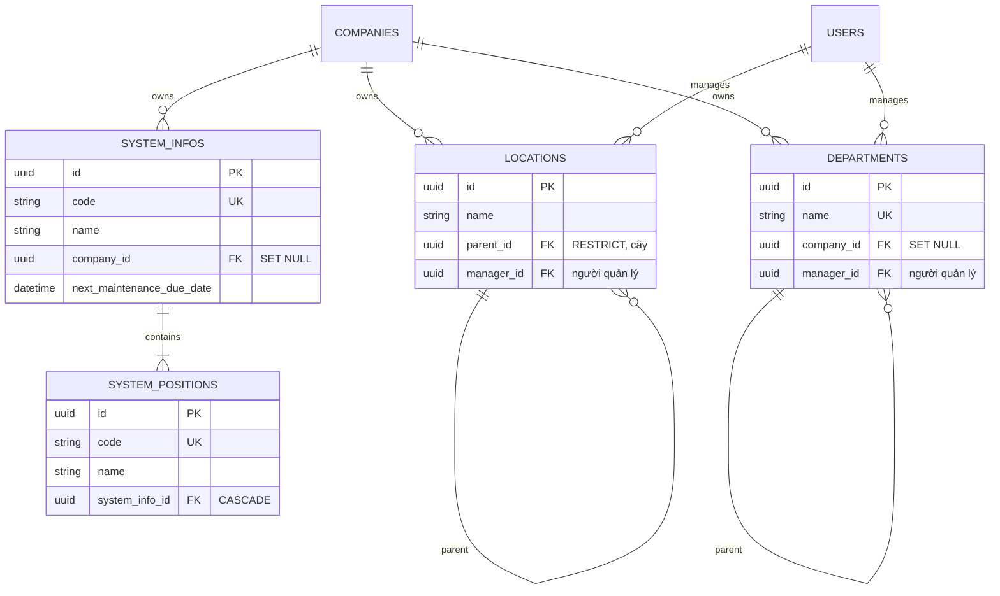

# 06 — ERD nhóm hệ thống – vị trí – địa điểm – phòng ban

> Hệ thống (`system_infos`) chứa vị trí (`system_positions`); địa điểm và phòng
> ban có cấu trúc cây.

## 1. Mục đích / đối tượng đọc

Dev làm việc với gán tài sản/linh kiện cho vị trí, checklist bảo dưỡng theo vị
trí, company-scoping của master-data.

## 2. Sơ đồ

## 3. Quy tắc xóa

- Xóa position đang được checklist tham chiếu → `400 POSITION_IN_USE_BY_CHECKLIST`
  (cả khi xóa position lẫn system chứa nó).
- Xóa system đang có campaign → `400 SYSTEM_IN_USE_BY_CAMPAIGN`.
- Xóa location/department đang được tham chiếu → `400 LOCATION_IN_USE` /
  `DEPARTMENT_IN_USE`.

## Nguồn tham chiếu

- `aspire-react/aspire-react.Infrastructure/Persistence/AppDbContext.cs:260-291,422-430` (departments, systems, positions, locations)
- `aspire-react/aspire-react.Server/Web/Controllers/SystemInfoController.cs:17-91` (routes)
- `docs/ERROR_CODES.md` (section Locations, Departments, SystemInfos)
