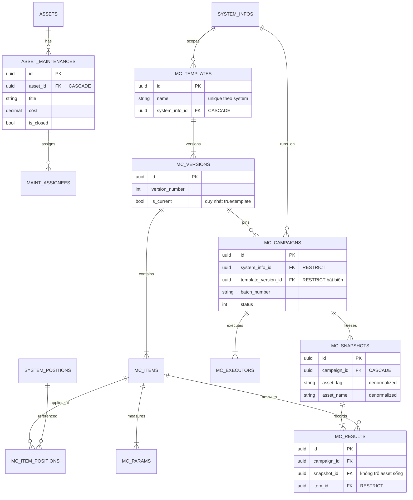

# 07 — ERD nhóm bảo dưỡng

> Hai luồng bảo dưỡng: phiếu lẻ (`asset_maintenances`) và đợt checklist
> (`templates → versions → items → campaigns → results`).

## 1. Mục đích / đối tượng đọc

Dev bảo trì: bất biến version khi đã pin campaign, snapshot thiết bị, quy tắc
ghi kết quả duy nhất.

## 2. Sơ đồ

## 3. Bất biến phải nhớ

- Version đã pin campaign: immutable (sửa/xóa → `TEMPLATE_VERSION_IN_USE`).
- Snapshot denormalized (không FK tới asset/position) — kết quả luôn trỏ
  snapshot, sống sót khi asset đổi.
- Kết quả duy nhất theo (campaign, snapshot, item, param) — 2 partial unique
  index xử lý `StandardParamId` NULL (`AppDbContext.cs:418-419`).
- Phiếu lẻ: workflow tạo → kiểm tra (inspect) → đóng (close) → mở lại
  (superuser).

## Nguồn tham chiếu

- `aspire-react/aspire-react.Infrastructure/Persistence/AppDbContext.cs:293-420,595-631` (toàn bộ MC + phiếu lẻ)
- `docs/ERROR_CODES.md` (section MaintenanceTemplates, MaintenanceCampaigns, AssetMaintenances)
