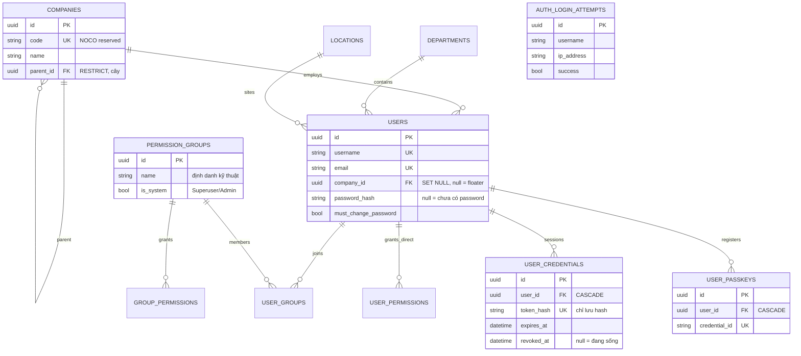

# 08 — ERD nhóm người dùng – phân quyền

> Công ty (cây) → người dùng → nhóm → quyền; kèm bảng auth (credentials,
> passkey, login attempts).

## 1. Mục đích / đối tượng đọc

Dev phân quyền + admin tạo nhóm: hiểu user nhận quyền từ đâu (trực tiếp hay
qua nhóm), 2 nhóm hệ thống, superuser bypass ở đâu.

## 2. Sơ đồ

## 3. Quy tắc

- User không công ty (`CompanyId = null`) = **floater** — thấy dữ liệu floater +
  theo scope cho phép; xóa tham chiếu bằng sentinel `Guid.Empty` (xem `docs/API.md`).
- Nhóm hệ thống (`IsSystem`: Superuser, Admin — seed khi chưa có) không
  rename/xóa (`SYSTEM_GROUP_LOCKED`); Superuser group giữ mọi quyền catalog.
- Quyền hiệu lực = hợp của quyền trực tiếp + quyền các nhóm; `superuser` bypass
  mọi kiểm tra; `admin` policy là wildcard (xem `13-phan-quyen.md`).
- Xóa user = soft-delete (vô hiệu hóa); tự hạ quyền mình → `SELF_LOCKOUT`.

## Nguồn tham chiếu

- `aspire-react/aspire-react.Infrastructure/Persistence/AppDbContext.cs:86-193` (companies, users, credentials, passkeys, attempts, groups)
- `aspire-react/aspire-react.Infrastructure/Persistence/StartupDataSeeder.cs:27-93` (seed Superuser/Admin + grant toàn catalog)
- `aspire-react/aspire-react.Domain/Authorization/PermissionCatalog.cs:16-140`
- `docs/ERROR_CODES.md` (section Auth, Users, Groups)
