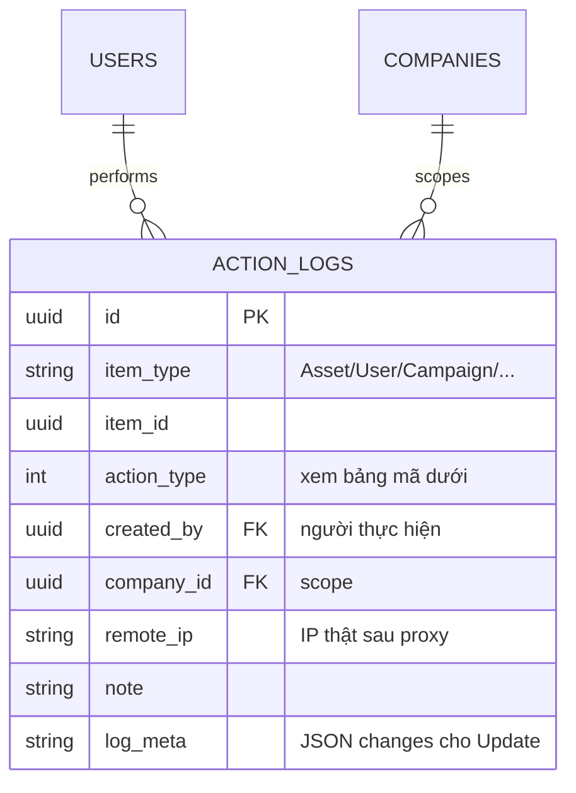

# 09 — ERD nhóm nhật ký (ActionLog)

> Mọi thay đổi nghiệp vụ đều để lại dấu vết trong `action_logs` — cùng
> transaction với thay đổi (atomic), không sửa/xóa log.

## 1. Mục đích / đối tượng đọc

Dev (bắt buộc ghi log cho action mới), admin tra cứu lịch sử, kiểm toán.

## 2. Sơ đồ

Mã `action_type` → nhãn UI (trích `ActionLogTable.tsx:34-50`): 1 Tạo mới ·
2 Cập nhật · 3 Xóa · 4 Cấp phát · 5 Thu hồi · 6 Kiểm kê · 7 Import · 8 Export ·
9 Chấp nhận · 10 Từ chối · 11 Xác nhận · 12 Lưu trữ · 13 Mở lại · 14 Cập nhật bị
từ chối · 15 Nhập kho · 16 Đánh dấu hỏng · 17 Loại bỏ.

## 3. Quy tắc

- Mọi Create/Update/Delete/Checkout/Checkin/... đều ghi log với `TargetType`,
  `TargetId`, `CompanyId` (+ `LogMeta.changes` cho Update), cùng transaction.
- Request bị chặn validation/company-scope **không tạo log**.
- `RemoteIp` là IP đã qua middleware trusted-proxy (xem `14-trien-khai.md`).
- Đọc qua `/api/v1/action-logs*` (read-only, company-scoped); trang
  Lịch sử hệ thống (`/system-history`).

## Nguồn tham chiếu

- `aspire-react/aspire-react.Infrastructure/Persistence/AppDbContext.cs:454-463` (bảng)
- `aspire-react/aspire-react.Application/Common/Behaviors/ActionLogBehavior.cs:26` (atomic cùng transaction)
- `aspire-react/aspire-react.Domain/Entities/ActionLog.cs:7-38` (cột)
- `aspire-react/frontend/src/shared/components/ActionLogTable.tsx:34-50` (nhãn)
- `docs/DEVELOPMENT_WORKFLOW.md` (§3.2 ActionLog)
