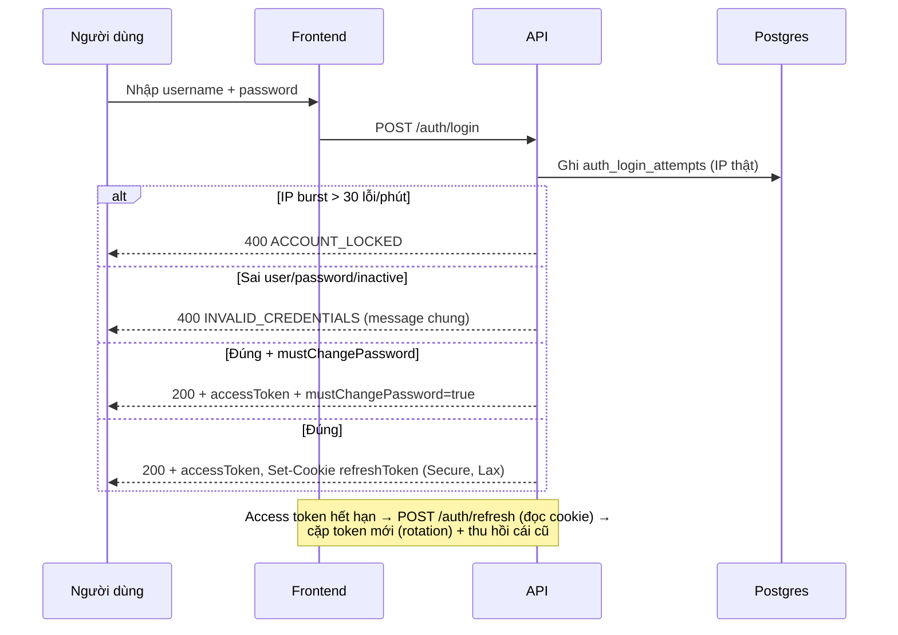
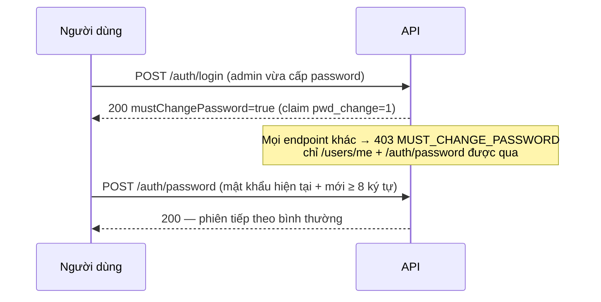

# 10 — Sequence xác thực: đăng nhập, refresh, đổi MK bắt buộc, passkey

> Mọi bước đăng nhập/đổi mật khẩu của người dùng, kèm mã lỗi thật.

## 1. Mục đích / đối tượng đọc

Dev auth + admin hỗ trợ user: biết token đi đâu, khi nào bị khóa, passkey chạy
khi nào.

## 2. Đăng nhập password + refresh

- Refresh token chỉ lưu **hash** (`user_credentials`), rotation + thu hồi,
  phát hiện tái sử (`INVALID_CREDENTIALS` + thu hồi toàn bộ session).
- Cookie `Secure` → chỉ chạy qua HTTPS (xem `14-trien-khai.md`).

## 3. Đổi mật khẩu bắt buộc

## 4. Passkey (tùy chọn, theo domain HTTPS)

`POST /auth/passkeys/register/options` → `POST /auth/passkeys/register` (lưu
`user_passkeys`) · `POST /auth/passkeys/login/options` → `POST
/auth/passkeys/login` (gộp lỗi thành `INVALID_CREDENTIALS` 401 chống enumeration)
· `DELETE /auth/passkeys/{id}`. Bật/tắt bằng SystemSetting
`auth.passkeys.enabled`; RP/Origins đọc từ env (`Auth:WebAuthn:*`).

## Nguồn tham chiếu

- `aspire-react/aspire-react.Server/Web/Controllers/AuthController.cs:32-45,47-63` (login, refresh)
- `aspire-react/aspire-react.Application/Auth/Commands/AuthCommands.cs:60-109,150-167` (lockout, rotation)
- `aspire-react/aspire-react.Infrastructure/Authentication/PasswordChangeGateMiddleware.cs` (gate 403)
- `aspire-react/aspire-react.Infrastructure/Authentication/AuthCookieService.cs:27-38` (Secure+Lax)
- `docs/ERROR_CODES.md` (section Auth)
