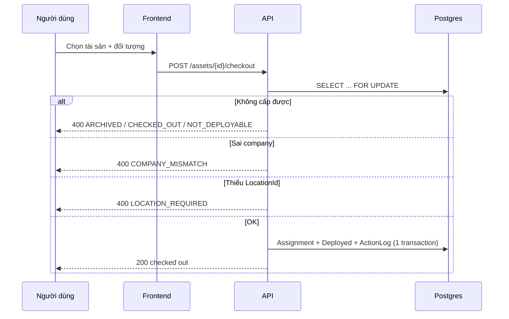

# 11 — Sequence cấp phát / thu hồi tài sản

> Luồng checkout/checkin tài sản — khóa hàng chống race, kiểm tra company,
> ghi ActionLog cùng transaction.

## 1. Mục đích / đối tượng đọc

Dev nghiệp vụ cấp phát + admin xử lý lỗi `COMPANY_MISMATCH`/`LOCATION_REQUIRED`.

## 2. Sơ đồ (checkout)

Thu hồi (`POST /assets/{id}/checkin`): asset phải đang Deployed + đang được cấp
(`ASSET_NOT_CHECKED_OUT`/`ASSET_NOT_DEPLOYED` nếu không) → Status về Pending,
không bao giờ tự archive.

## 3. Các phân hệ khác (cùng mẫu)

- Vật tư: checkout theo số lượng (`INVALID_QUANTITY`, `INSUFFICIENT_STOCK`),
  target (`TARGET_REQUIRED`/`TARGET_NOT_FOUND`, `CONSUMABLE_COMPANY_MISMATCH`).
- Linh kiện: serial (`SERIAL_NOT_FOUND`, `DUPLICATE_SERIAL`, tồn kho).
- Phụ kiện: `INSUFFICIENT_STOCK`, checkin theo số lượng
  (`INVALID_RETURN_QTY`/`EXCEEDS_CHECKED_OUT`).
- License seat: `SEAT_ALREADY_ASSIGNED` (mutex `FOR UPDATE`),
  `NO_AVAILABLE_SEATS`, `LICENSE_COMPANY_MISMATCH`.

## Nguồn tham chiếu

- `aspire-react/aspire-react.Application/Assets/Commands/CheckoutAssetCommand.cs:93-191` (lock, guards, transaction)
- `docs/ERROR_CODES.md` (section Assets, Consumables, Components, Accessories, Licenses)
