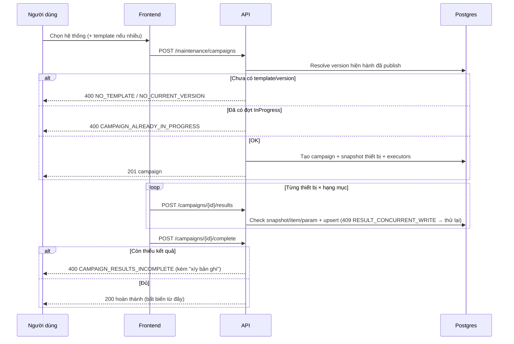

# 12 — Sequence đợt bảo dưỡng: tạo → ghi kết quả → hoàn thành

> Từ template version tới campaign, snapshot thiết bị, upsert kết quả, complete.

## 1. Mục đích / đối tượng đọc

Kỹ thuật bảo trì + dev: hiểu pin version, snapshot, quy tắc ghi kết quả.

## 2. Sơ đồ

## 3. Quy tắc nhớ

- Campaign pin **version hiện hành đã publish** — version đó bất biến.
- Snapshot denormalized: đổi asset/vị trí sau này không ảnh hưởng kết quả cũ.
- Ghi đè kết quả cho phép tới khi complete; campaign hoàn thành thì khóa
  (`CAMPAIGN_COMPLETED`).
- Race ghi cùng ô → `409 RESULT_CONCURRENT_WRITE` (duy nhất toàn API) — client
  thử lại.

## Nguồn tham chiếu

- `aspire-react/aspire-react.Server/Web/Controllers/MaintenanceCampaignsController.cs:81-141,141-210` (create, results, complete)
- `aspire-react/aspire-react.Application/MaintenanceCampaigns/CampaignAccess.cs:61-87` (resolve version)
- `docs/ERROR_CODES.md` (section MaintenanceCampaigns, duy nhất 409)
