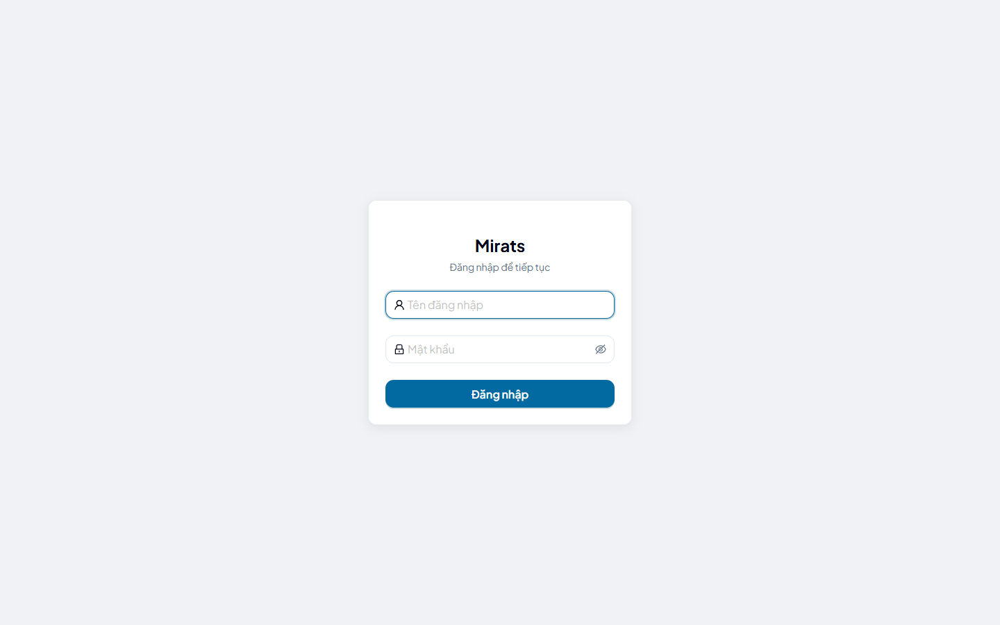
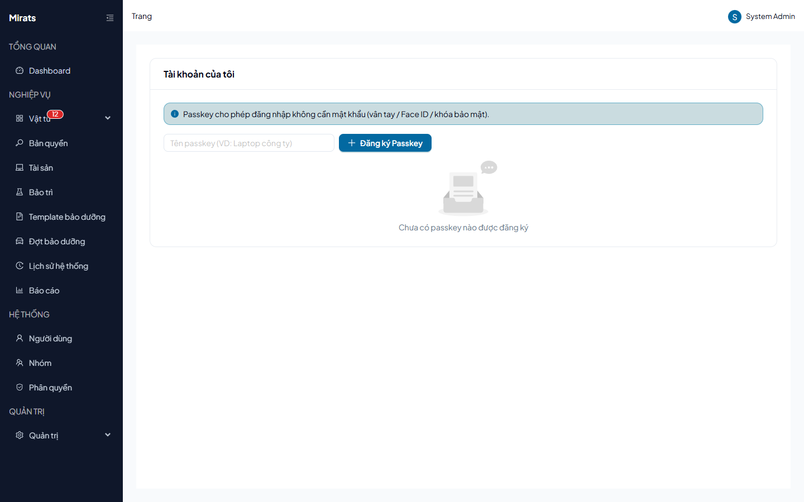

# 20 — Đăng nhập, đổi mật khẩu, passkey

> Cách vào hệ thống, đổi mật khẩu lần đầu, đăng ký passkey.

## 1. Ai dùng (quyền cần có)

Mọi người dùng (kể cả chưa có quyền gì cũng đăng nhập và mở trang Tài khoản của
mình được).

## 2. Đăng nhập

1. Mở trang đăng nhập, nhập **Tên đăng nhập** + **Mật khẩu** → **Đăng nhập**.
2. Sai thông tin → thông báo chung "Sai tên đăng nhập hoặc mật khẩu."
   (không cho biết sai chỗ nào — chống dò username).
3. Nhập sai nhiều lần → "Tài khoản tạm thời bị khóa..." — chờ hết thời gian
   rồi thử lại, không thử dồn.

## 3. Đổi mật khẩu bắt buộc

Tài khoản do admin cấp lần đầu bắt buộc đổi mật khẩu: sau khi đăng nhập,
hệ thống chuyển thẳng tới màn hình đổi mật khẩu, các trang khác báo `403`
cho tới khi đổi xong.

1. Nhập **Mật khẩu hiện tại** (mật khẩu admin vừa cấp).
2. Nhập **Mật khẩu mới** (≥ 8 ký tự) + xác nhận → Lưu.
3. Từ phiên sau dùng mật khẩu mới.

Lỗi thường gặp: mật khẩu mới < 8 ký tự → `400` "Validation failed." (kèm chi
tiết `errors`); mật khẩu hiện tại sai → `400 INVALID_CREDENTIALS`
("Mật khẩu hiện tại không đúng.").

## 4. Passkey (tùy chọn)

1. Mở **Tài khoản & Passkey** (menu avatar) → mục Passkey → **Đăng ký passkey**,
   làm theo trình duyệt (vân tay/khóa USB).
2. Lần sau chọn **Đăng nhập bằng Passkey** ngay tại trang đăng nhập.
3. Xóa passkey không dùng nữa bằng nút Xóa cạnh từng passkey.

Lỗi thường gặp: nút passkey không hiện = admin chưa bật trong Cấu hình hệ
thống; đăng ký quá hạn thao tác → `400 PASSKEY_REGISTRATION_EXPIRED` (làm lại
từ đầu); trình duyệt không hỗ trợ hoặc đang truy cập bằng IP (passkey đòi
domain HTTPS).

## Nguồn tham chiếu

- `aspire-react/frontend/src/features/auth/pages/LoginPage.tsx:16-96` (form, passkey)
- `aspire-react/frontend/src/features/auth/pages/AccountPage.tsx` (mục passkey)
- `docs/ERROR_CODES.md` (section Auth: `INVALID_CREDENTIALS`, `ACCOUNT_LOCKED`, `MUST_CHANGE_PASSWORD`, `PASSKEY_*`)
