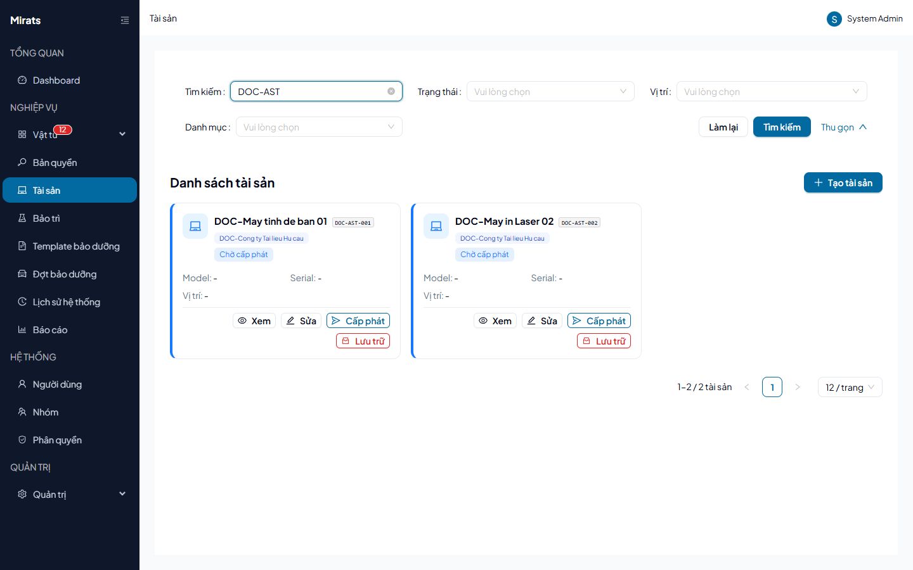
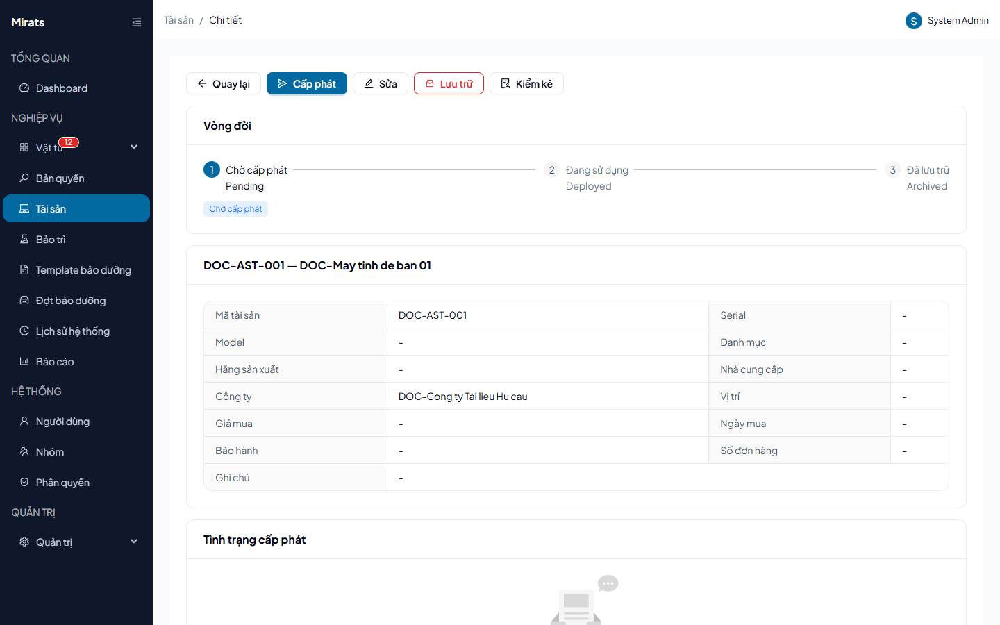

# 21 — Tài sản: xem, tạo, cấp phát, thu hồi

> Quản lý vòng đời tài sản: Chờ cấp phát → Đang sử dụng → Đã lưu trữ.

## 1. Ai dùng (quyền cần có)

`assets.view` (xem), `assets.create` (tạo), `assets.edit` (sửa), `assets.delete`
(xóa), `assets.checkout` (cấp phát), `assets.checkin` (thu hồi),
`assets.audit` (kiểm kê). Không có quyền → nút tương ứng ẩn.

## 2. Xem danh sách + chi tiết

1. Mở **Tài sản** → lọc theo **Tìm kiếm** (tên/mã/serial), **Trạng thái**,
   **Vị trí**, **Danh mục** → **Tìm kiếm**.
2. Mỗi thẻ hiện mã, tên, công ty, trạng thái (`Chờ cấp phát`/`Đã cấp phát`/
   `Đã thu hồi` — xem `ASSET_STATUS_LABELS`), model/serial/vị trí.
3. Bấm **Xem** vào trang chi tiết: vòng đời 3 bước, thông tin đầy đủ, tình
   trạng cấp phát.

## 3. Tạo / sửa / xóa

- **Tạo tài sản**: mã (bắt buộc, duy nhất — trùng → `400`
  "Mã tài sản đã tồn tại trong hệ thống."), tên, công ty (user thường chỉ được
  tạo cho công ty mình — sai → `400 COMPANY_MISMATCH`).
- **Sửa**: asset đã xác nhận chỉ sửa được Tên/Ghi chú (đụng field khóa →
  `400 CONFIRMED_ASSET_LOCKED`).
- **Xóa**: asset đã xác nhận/đang cấp/có lịch sử/có bảo trì → `400`
  (`ASSET_CONFIRMED_CANNOT_DELETE`, `ASSET_CHECKED_OUT`,
  `ASSET_HAS_ASSIGNMENTS`, `ASSET_HAS_MAINTENANCES`).

## 4. Cấp phát / thu hồi / lưu trữ / kiểm kê

1. **Cấp phát**: chọn đối tượng (Người dùng/Phòng ban/Hệ thống — tới Hệ thống
   phải chọn **Vị trí** kèm theo, thiếu → `400 LOCATION_REQUIRED`); target khác
   công ty → `400 COMPANY_MISMATCH`. Asset chuyển sang `Đã cấp phát`.
2. **Thu hồi**: asset đang cấp mới thu được (`ASSET_NOT_CHECKED_OUT` nếu không)
   → về `Chờ cấp phát` (không bao giờ tự lưu trữ).
3. **Lưu trữ / Mở lưu trữ**: `archive`/`unarchive` (lưu trữ 2 lần →
   `ALREADY_ARCHIVED`).
4. **Kiểm kê** (`assets.audit`): xác nhận tồn tại định kỳ.

## Nguồn tham chiếu

- `aspire-react/frontend/src/features/asset/pages/AssetListPage.tsx:77-89` (bộ lọc), `AssetDetailPage.tsx:32-35` (vòng đời)
- `aspire-react/frontend/src/features/asset/types/asset.ts:19-23` (nhãn trạng thái), `:94-108` (ma trận nút theo state)
- `docs/ERROR_CODES.md` (section Assets)
