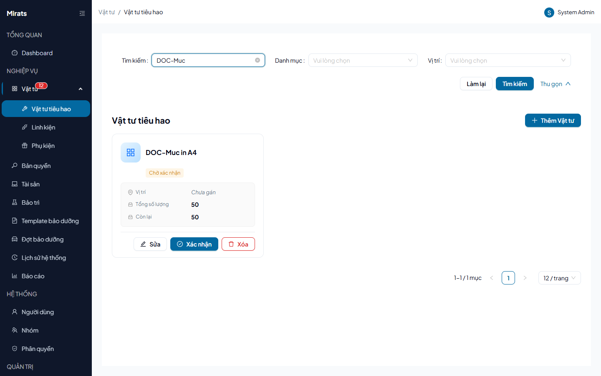

# 22 — Vật tư tiêu hao: nhập kho, cấp phát

> Vật tư dùng dần theo số lượng (mực in, giấy, linh kiện thay thế lẻ).

## 1. Ai dùng (quyền cần có)

`consumables.view` · `consumables.create` · `consumables.edit` ·
`consumables.delete` · `consumables.checkout`.

## 2. Thao tác

1. **Thêm vật tư**: tên, số lượng, công ty. Vật tư mới ở trạng thái
   `Chờ xác nhận` — bấm **Xác nhận** mới được cấp phát (cấp khi chưa confirm →
   `400 CONSUMABLE_NOT_CONFIRMED`).
2. **Cấp phát**: nhập số lượng (> 0, không vượt tồn — sai → `400
   INVALID_QUANTITY`/`INSUFFICIENT_STOCK`), chọn người nhận
   (`TARGET_REQUIRED`/`TARGET_NOT_FOUND` khi thiếu/sai); người nhận khác công
   ty → `400 CONSUMABLE_COMPANY_MISMATCH`.
3. **Sửa/xóa**: đổi công ty khi đã có checkout → `400 FIELD_LOCKED`; xóa khi đã
   từng cấp phát → `400 CONSUMABLE_HAS_CHECKOUTS`.

## 3. Lỗi thường gặp

| Hiện tượng | Nguyên nhân (message thật) |
|---|---|
| Không cấp được hàng mới tạo | Chưa bấm Xác nhận (`CONSUMABLE_NOT_CONFIRMED`) |
| Số lượng báo đỏ | `INVALID_QUANTITY` (≤ 0) / `INSUFFICIENT_STOCK` (vượt tồn) |
| Không xóa được | Đã từng cấp phát (`CONSUMABLE_HAS_CHECKOUTS`) |

## Nguồn tham chiếu

- `aspire-react/frontend/src/features/consumable/pages/ConsumableListPage.tsx:182-206` (bộ lọc), `ConsumableDetailPage.tsx:139-179` (lịch sử cấp)
- `docs/ERROR_CODES.md` (section Consumables)
