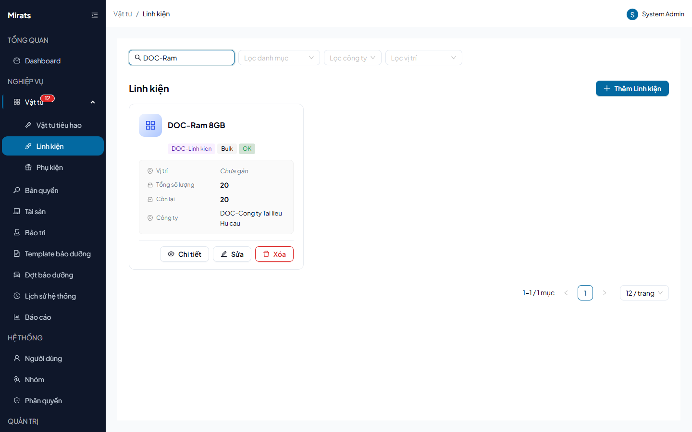

# 23 — Linh kiện: theo dõi Bulk và Serial

> Linh kiện có 2 kiểu theo dõi: `Bulk` (theo số lượng chung) và `Serial`
> (từng chiếc có số serial riêng, trạng thái Trong kho/Đã cấp phát/Hư hỏng/
> Đã loại bỏ).

## 1. Ai dùng (quyền cần có)

`components.view` · `components.create` · `components.edit` ·
`components.delete` · `components.checkout` (cấp phát/điều chuyển).

## 2. Thao tác

1. **Tạo linh kiện**: tên + **danh mục đúng loại Linh kiện** (sai loại →
   `400 INVALID_CATEGORY`); công ty (thiếu/sai → `COMPANY_REQUIRED`/
   `INVALID_COMPANY`/`COMPANY_MISMATCH`); chọn kiểu theo dõi.
2. **Serial**: mỗi serial là một dòng riêng (`SerialNo` duy nhất — trùng →
   `400 DUPLICATE_SERIAL`); đổi trạng thái serial (Trong kho ↔ Hư hỏng ↔
   Loại bỏ) ngay trên chi tiết.
3. **Cấp phát**: Bulk trừ tồn (`INSUFFICIENT_STOCK` khi hết); Serial gán từng
   chiếc (`SERIAL_NOT_FOUND`, `ALREADY_DELETED` với serial đã xóa mềm).
4. **Xóa**: đã từng cấp phát → `400 COMPONENT_HAS_ALLOCATION_HISTORY`
   (lịch sử giữ lại vĩnh viễn).

## 3. Lỗi thường gặp

| Hiện tượng | Nguyên nhân (message thật) |
|---|---|
| Không tạo được | Thiếu danh mục (`CATEGORY_REQUIRED`) / sai loại (`INVALID_CATEGORY`) |
| Không xóa được | Đã từng cấp phát (`COMPONENT_HAS_ALLOCATION_HISTORY`) |
| Serial báo trùng | `DUPLICATE_SERIAL` (kể cả serial đã xóa mềm của chính nó) |

## Nguồn tham chiếu

- `aspire-react/frontend/src/features/component/services/components.service.ts:3-4` (`TrackingType`, `ComponentUnitStatus`)
- `aspire-react/frontend/src/features/component/pages/ComponentDetailPage.tsx:21-31` (nhãn trạng thái serial)
- `docs/ERROR_CODES.md` (section Components, ComponentUnits)
