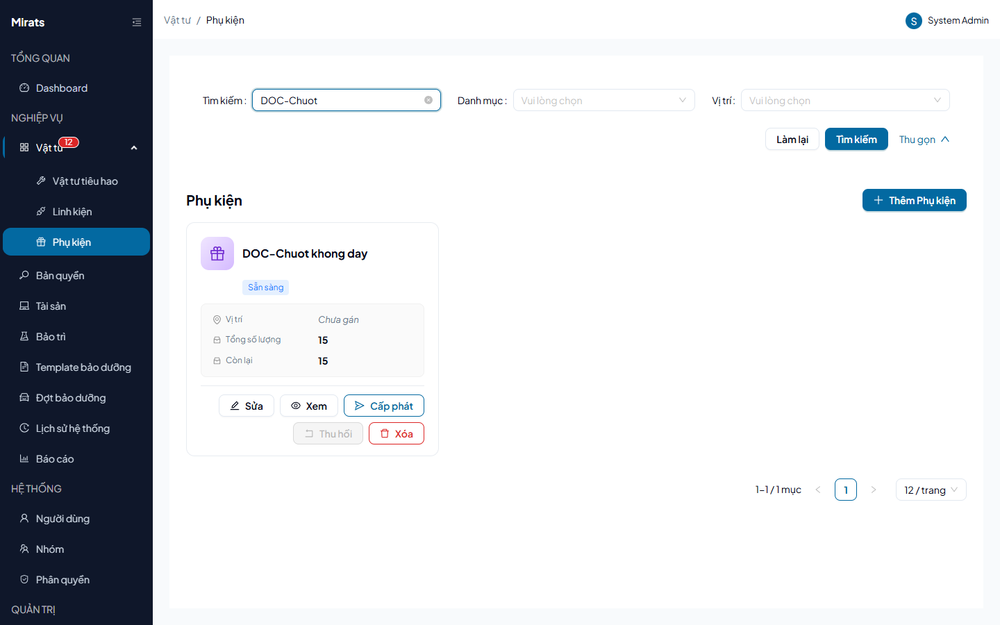

# 24 — Phụ kiện: cấp phát và thu hồi theo số lượng

> Phụ kiện cấp cho người dùng/phòng ban/vị trí/hệ thống, thu hồi được một phần.

## 1. Ai dùng (quyền cần có)

`accessories.view` · `accessories.create` · `accessories.edit` ·
`accessories.delete` · `accessories.checkout`.

## 2. Thao tác

1. **Thêm phụ kiện**: tên, tổng số lượng, công ty.
2. **Cấp phát**: chọn đối tượng nhận (Người dùng = 1, Phòng ban = 2, Vị trí = 3,
   Hệ thống = 4) + số lượng (không vượt tồn → `400 INSUFFICIENT_STOCK`).
3. **Thu hồi**: trả một phần hoặc toàn bộ (`INVALID_RETURN_QTY` khi số trả ≤ 0,
   `EXCEEDS_CHECKED_OUT` khi trả quá số đang giữ); `CHECKOUT_NOT_FOUND` khi
   bản ghi cấp phát không tồn tại.
4. **Sửa/xóa**: đổi công ty khi đã có checkout → `400 FIELD_LOCKED`; xóa khi đã
   từng cấp phát → `400 ACCESSORY_HAS_CHECKOUTS`.

## Nguồn tham chiếu

- `aspire-react/frontend/src/features/accessory/pages/AccessoryListPage.tsx:243-273` (bộ lọc), `AccessoryDetailPage.tsx:76-94` (bảng cấp phát)
- `aspire-react/frontend/src/features/accessory/services/accessories.service.ts:70-75` (nhãn loại đối tượng)
- `docs/ERROR_CODES.md` (section Accessories)
