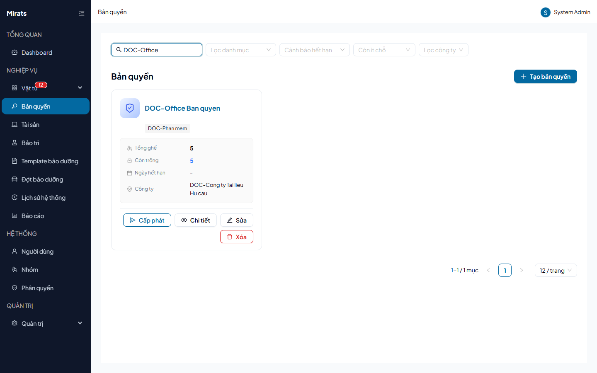

# 25 — Bản quyền phần mềm: quản lý seat

> Mỗi bản quyền có N chỗ (`Tổng ghế`/`Còn trống`), cấp seat cho Người dùng /
> Tài sản / Hệ thống, thu hồi khi luân chuyển.

## 1. Ai dùng (quyền cần có)

`licenses.view` · `licenses.create` · `licenses.edit` · `licenses.delete` ·
`licenses.checkout` (cấp + thu hồi seat).

## 2. Thao tác

1. **Tạo bản quyền**: tên + danh mục đúng loại + số ghế (≥ 1 —
   `SEATS_MIN_1` nếu không). Hệ thống tự sinh đủ dòng seat.
2. **Cấp phát**: chọn seat trống hoặc để hệ thống tự lấy seat trống
   (`NO_AVAILABLE_SEATS` khi hết); chọn đối tượng (`TARGET_REQUIRED`/
   `TARGET_NOT_FOUND`, sai loại → `INVALID_TARGET_TYPE`, nhập nhằng →
   `SEAT_TARGET_AMBIGUOUS`); đối tượng khác công ty → `400
   LICENSE_COMPANY_MISMATCH`. Seat đang giữ cấp tiếp → `400
   SEAT_ALREADY_ASSIGNED`.
3. **Thu hồi**: seat chưa cấp mà thu → `400 SEAT_NOT_ASSIGNED`; bản quyền
   không cho cấp lại → `400 LICENSE_NOT_REASSIGNABLE`.
4. **Sửa/xóa**: đổi Danh mục/Công ty → `400 FIELD_LOCKED`; giảm tổng ghế dưới
   mức đang dùng → `400 CANNOT_REDUCE_SEATS_IN_USE`; xóa khi còn seat đã cấp →
   `400 LICENSE_IN_USE`.

## Nguồn tham chiếu

- `aspire-react/frontend/src/features/license/services/licenses.service.ts:3` (`LicenseSeatTargetType`)
- `docs/ERROR_CODES.md` (section Licenses)
