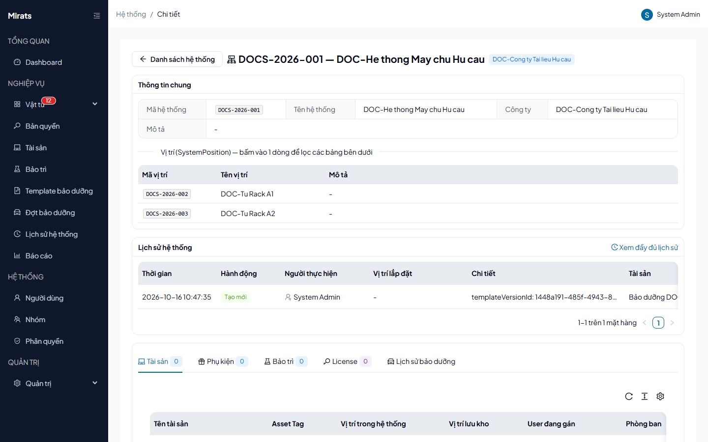

# 26 — Hệ thống và vị trí lắp đặt

> Hệ thống (`DOCS-2026-001`) chứa các vị trí (`DOCS-2026-002`...) — nơi gắn
> tài sản, linh kiện, và là phạm vi của checklist bảo dưỡng.

## 1. Ai dùng (quyền cần có)

`systems.view` · `systems.create` · `systems.edit` · `systems.delete`.

## 2. Thao tác

1. **Tạo hệ thống**: **Mã** đúng định dạng `XXX(X)-YYYY-ZZZ` (3–4 chữ hoa +
   `-` + 4 số + `-` + 3 số, VD `DOCS-2026-001`; sai → `400` không error_code
   "Mã hệ thống phải đúng định dạng..."), Tên, Công ty.
2. **Thêm vị trí**: trong chi tiết hệ thống, thêm vị trí cùng định dạng mã.
   Bấm 1 dòng vị trí để lọc các bảng bên dưới (tài sản, phụ kiện, bảo trì,
   license gắn tại vị trí đó).
3. **Xóa**: vị trí đang được checklist tham chiếu → `400
   POSITION_IN_USE_BY_CHECKLIST`; hệ thống đang có đợt bảo dưỡng → `400
   SYSTEM_IN_USE_BY_CAMPAIGN`; trùng mã → `400` không error_code.

## Nguồn tham chiếu

- `aspire-react/frontend/src/features/admin/pages/SystemInfoListPage.tsx:122-161` (cột hệ thống/vị trí)
- `aspire-react/aspire-react.Application/SystemInfos/SystemCodeRules.cs:12` (regex mã)
- `docs/ERROR_CODES.md` (section SystemInfos)
