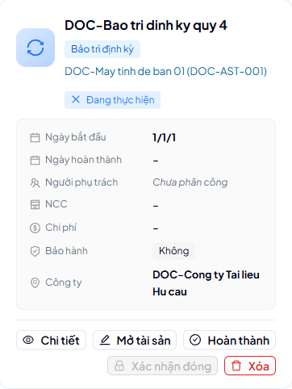

# 27 — Bảo trì tài sản (phiếu lẻ)

> Phiếu bảo trì cho từng tài sản: tạo → (phân công) → kiểm tra → đóng; mở lại
> khi cần (superuser).

## 1. Ai dùng (quyền cần có)

Trang Bảo trì (phiếu lẻ) yêu cầu `assets.view`. Đóng/mở lại/đánh dấu kiểm tra là
thao tác nhạy cảm, audit đầy đủ.

## 2. Thao tác

1. **Tạo phiếu**: từ trang Bảo trì (**Thêm bảo trì**) hoặc từ chi tiết tài sản;
   nhập **Tiêu đề** (thiếu → `400 TITLE_REQUIRED`), tài sản, ngày bắt đầu, chi
   phí (âm → `400 INVALID_COST`), NCC (không tồn tại → `400 INVALID_SUPPLIER`),
   tối đa 5 người thực hiện (`MAX_5_ASSIGNEES`, người không tồn tại →
   `INVALID_ASSIGNEE`, khác công ty → `ASSIGNEE_COMPANY_MISMATCH`).
2. **Kiểm tra** (inspect): sau khi hoàn thành thực tế, ghi ngày hoàn thành
   (trước ngày bắt đầu → `COMPLETION_BEFORE_START`) rồi kiểm tra.
3. **Đóng** (close): chỉ khi đã kiểm tra (`MAINTENANCE_NOT_INSPECTED_YET` nếu
   chưa) và đã có ngày hoàn thành (`MAINTENANCE_NOT_COMPLETED_YET`). Bản ghi đã
   đóng là bất biến (sửa → `400 MAINTENANCE_CLOSED`).
4. **Mở lại** (reopen, superuser): bản chưa đóng mà mở → `400
   MAINTENANCE_NOT_CLOSED`.

## Nguồn tham chiếu

- `docs/ERROR_CODES.md` (section AssetMaintenances — trap 403/404 §1.2)
