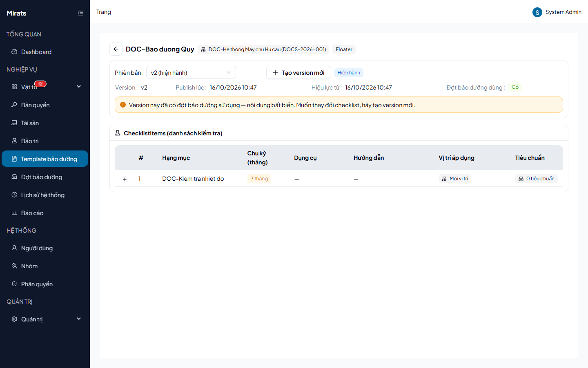
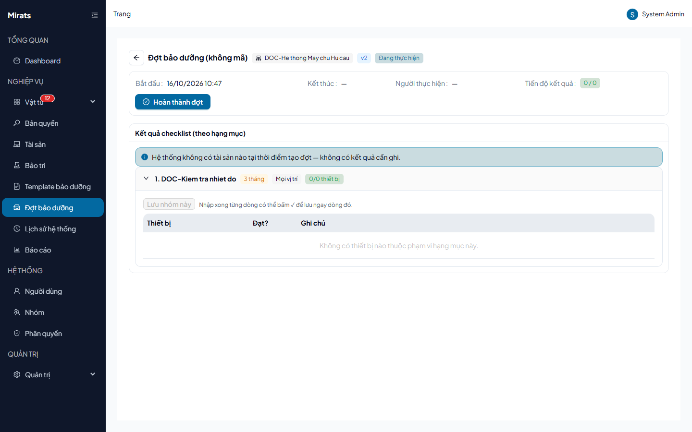

# 28 — Bảo dưỡng định kỳ: template → đợt → ghi kết quả → hoàn thành

> Quy trình checklist theo hệ thống: soạn template (version) → tạo đợt → ghi kết
> quả từng thiết bị → hoàn thành đợt.

## 1. Ai dùng (quyền cần có)

Trang Template yêu cầu `maintenance.templates`; trang Đợt yêu cầu
`maintenance.view` (ghi kết quả/hoàn thành cần `maintenance.campaigns`).

## 2. Soạn template

1. Mở **Template bảo dưỡng** → tạo template (Tên + Hệ thống; trùng tên trong
   cùng hệ thống → `400 TEMPLATE_NAME_TAKEN`).
2. Thêm **Hạng mục** (tên — thiếu → `400 ITEM_NAME_REQUIRED`, chu kỳ tháng,
   thứ tự — trùng → `400 ITEM_ORDER_TAKEN`) và khai báo **Vị trí áp dụng**
   (ngoài hệ thống → `400 INVALID_POSITION`).
3. Thêm **Tiêu chuẩn** cho hạng mục (tên + toán tử ngưỡng + giá trị ngưỡng bắt
   buộc — thiếu → `400 PARAM_REQUIRED`/`THRESHOLD_OPERATOR_REQUIRED`/
   `THRESHOLD_VALUE_REQUIRED`).
4. **Publish version**: version hiện hành bị khóa khi đã có đợt pin
   (`TEMPLATE_VERSION_IN_USE`); muốn sửa checklist → tạo version mới.

## 3. Tạo đợt và ghi kết quả

1. **Tạo đợt** từ hệ thống (tự pin version hiện hành; hệ thống chưa có template
   → `400 NO_TEMPLATE`; nhiều template mà không chỉ định → `400
   AMBIGUOUS_TEMPLATE`; đã có đợt đang chạy → `400
   CAMPAIGN_ALREADY_IN_PROGRESS`).
2. **Ghi kết quả** từng thiết bị × hạng mục (thiếu snapshot/item →
   `INVALID_DEVICE_SNAPSHOT`/`INVALID_CHECKLIST_ITEM`; cặp item–thiết bị ngoài
   phạm vi vị trí → `400 INVALID_ITEM_POSITION`; hạng mục có tiêu chuẩn mà
   không gửi → `400 STANDARD_PARAM_REQUIRED`). Ghi trùng ô cùng lúc →
   `409 RESULT_CONCURRENT_WRITE` — thử lại.
3. **Hoàn thành đợt** (`Hoàn thành đợt`): còn thiếu → `400
   CAMPAIGN_RESULTS_INCOMPLETE` (kèm "x/y bản ghi"); đủ → đợt bất biến, kết quả
   khóa (`CAMPAIGN_COMPLETED` khi sửa sau hoàn thành).

## Nguồn tham chiếu

- `aspire-react/frontend/src/features/maintenance/pages/MaintenanceTemplateBuilderPage.tsx:205-304` (CRUD item/param/version)
- `aspire-react/frontend/src/features/maintenance/pages/MaintenanceCampaignDetailPage.tsx:146-156` (lưu dòng, `saveRow`)
- `docs/ERROR_CODES.md` (section MaintenanceTemplates, MaintenanceCampaigns)
