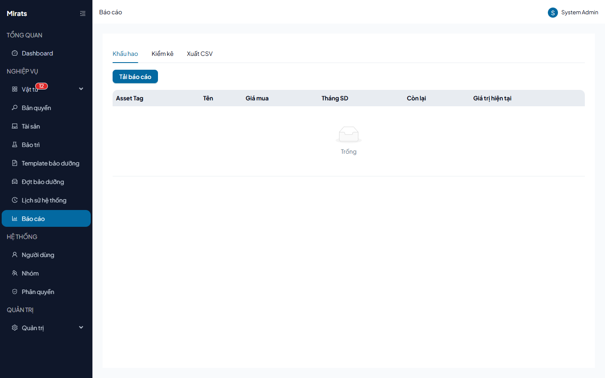
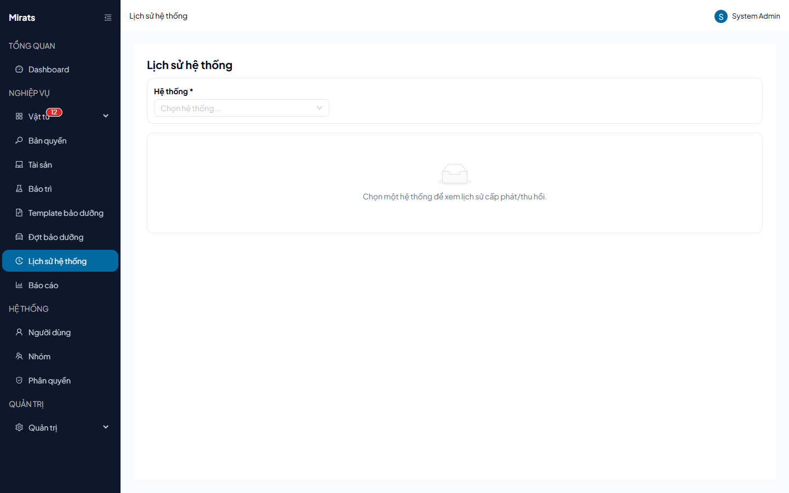

# 29 — Báo cáo và lịch sử hệ thống

> Xem báo cáo khấu hao/kiểm kê/xuất CSV và tra cứu lịch sử cấp phát theo hệ thống.

## 1. Ai dùng (quyền cần có)

Trang Báo cáo yêu cầu `reports.view`.

## 2. Báo cáo

1. Mở **Báo cáo**: 3 tab **Khấu hao** (giá trị còn lại theo số tháng sử dụng —
   cần tài sản gắn model có cấu hình khấu hao, nếu trống là bình thường),
   **Kiểm kê**, **Xuất CSV**.
2. **Tải báo cáo** để xem/sửa ngoài Excel; xuất tài sản ra file từ nút export
   (`/export/assets`).

## 3. Lịch sử hệ thống

1. Mở **Lịch sử hệ thống**, chọn 1 hệ thống → xem lịch sử cấp phát/thu hồi của
   các tài sản trong hệ thống đó.
2. Muốn tra toàn bộ mọi thay đổi (mọi loại đối tượng): dùng trang tra cứu
   ActionLog của admin (xem `09-erd-nhat-ky.md`).

## Nguồn tham chiếu

- `aspire-react/frontend/src/features/system/pages/ReportsPage.tsx:34-53` (depreciation, audit, export)
- `aspire-react/frontend/src/features/system/pages/SystemHistoryPage.tsx:90-133` (bộ lọc hệ thống)
- `aspire-react/frontend/src/App.tsx:136` (`/reports` cần `reports.view`)
